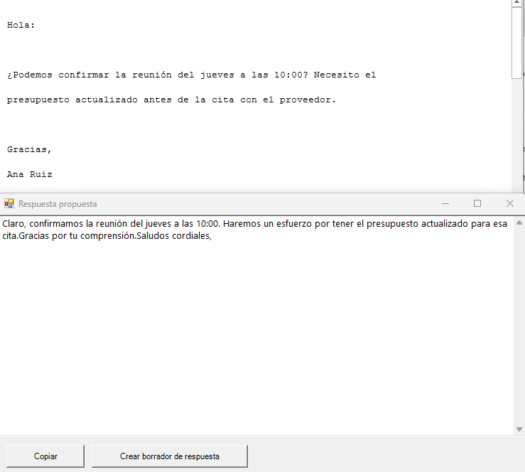

# Outlook AI

Asistente de IA **dentro de Outlook clásico**: redacta respuestas, resume, traduce y clasifica
el correo que tengas seleccionado, con un atajo de teclado y sin salir de Outlook.

- **Gratis si quieres**: funciona con un modelo local (Ollama), sin cuota y sin que el correo
  salga de tu equipo.
- **Sin suscripción**: si prefieres la nube, hay capas gratuitas (Groq, Gemini) y un motor de
  pago por uso (DeepSeek) a céntimos.
- **Nada se envía solo**: el resultado se muestra en un panel editable con botones para
  copiar o crear el borrador de respuesta.

> Alternativa libre a las extensiones de IA de pago para Outlook. Hecho con PowerShell y
> automatización COM: sin instaladores, sin frameworks, sin dependencias.



## Atajos

| Atajo | Función |
| --- | --- |
| `Ctrl+Alt+1` | Redactar respuesta formal |
| `Ctrl+Alt+2` | Resumir con puntos clave y acciones |
| `Ctrl+Alt+3` | Traducir al español |
| `Ctrl+Alt+4` | Clasificar y priorizar |
| `Ctrl+Alt+5` | Redactar respuesta cercana |
| `Ctrl+Alt+6` | Redactar respuesta muy breve |
| `Ctrl+Alt+7` | Traducir al inglés |

Si seleccionas varios correos, procesa hasta 10 (útil para resumir un hilo).

Referencia completa en [ATAJOS.md](ATAJOS.md).

## Requisitos

- **Windows 10 u 11** con **Outlook clásico** (Outlook 2016 o Microsoft 365). El «nuevo
  Outlook» no sirve: es una aplicación web y no expone la automatización COM.
- PowerShell 5.1 (viene con Windows).
- Un motor: **Ollama** (local, gratis) o una clave de **Groq**, **Gemini** o **DeepSeek**.

## Instalación

1. Descarga el repositorio (**Code → Download ZIP**) y descomprímelo.
2. En PowerShell, dentro de esa carpeta:

```powershell
powershell -ExecutionPolicy Bypass -File .\install.ps1
```

3. Inicio → **Outlook AI** → *Configurar motor y clave*.
4. Abre Outlook, selecciona un correo y pulsa `Ctrl+Alt+1`.

El instalador copia el script a `%LOCALAPPDATA%\OutlookAI` y crea los atajos en el menú Inicio.

## Elegir motor

| Motor | Coste | Privacidad | Velocidad media |
| --- | --- | --- | --- |
| **Ollama** (`qwen2.5:7b`) | Gratis siempre | Nada sale del equipo | 5-10 s por correo |
| **Groq** | Capa gratuita con límites | El correo va a Groq | 1-3 s |
| **Google Gemini** | Capa gratuita con límites | El correo va a Google | 1-3 s |
| **DeepSeek** | Pago por uso | El correo va a DeepSeek | 2-5 s |

### Opción gratis para siempre: Ollama

1. Instala Ollama: https://ollama.com/download
2. Descarga un modelo:

```powershell
ollama pull qwen2.5:7b    # ~4,7 GB, buena calidad en español (recomendado con 16 GB de RAM)
ollama pull qwen2.5:3b    # ~1,9 GB, más rápido, algo menos de matiz
```

3. *Configurar motor y clave* → Motor: **Ollama (local, gratis)**. Sin clave ni internet.

El modelo queda cargado en RAM mientras se usa y se libera solo tras unos minutos de
inactividad. Necesita unos 5 GB de RAM para el 7B y 2,5 GB para el 3B.

### Opción rápida sin instalar nada: Groq o Gemini

Crea una clave gratuita y pégala en la configuración:

- Groq: https://console.groq.com → *API Keys* (modelo `llama-3.3-70b-versatile`).
- Google Gemini: https://aistudio.google.com/apikey (modelo `gemini-3.5-flash`).

Los límites de las capas gratuitas cambian con el tiempo; para uso personal de correo suelen
ser de sobra. Si se agotan, el error lo indica (HTTP 429).

> **Si aparece un HTTP 404 con Gemini**, es que Google retiró o renombró ese modelo: el campo
> *Modelo* de la ventana de configuración es editable. Para ver los que acepta tu clave:
>
> ```powershell
> $k = "<tu clave>"
> (Invoke-RestMethod "https://generativelanguage.googleapis.com/v1beta/openai/models" -Headers @{ Authorization = "Bearer $k" }).data.id
> ```
>
> Elige uno que termine en `-flash` (los `pro` gastan cuota mucho más rápido).

## Cómo funciona

1. Lee el correo seleccionado por automatización COM (`Outlook.Application`).
2. Construye un prompt según el modo y tu tono.
3. Llama a un endpoint compatible con la API de OpenAI (`/chat/completions`), sea local o en
  la nube.
4. Muestra el texto en un panel WinForms con *Copiar* y *Crear borrador de respuesta* (este
  último abre un «Responder a todos» con el texto insertado encima del correo citado).

Todo es un único archivo de PowerShell de ~650 líneas. Sin compilar, sin dependencias.

## Privacidad

- **Con Ollama**: el correo no sale del equipo. Nada de red.
- **Con motores en la nube**: se envía el correo seleccionado (remitente, asunto, fecha y
  cuerpo, hasta 12 000 caracteres) y el prompt del modo. **No** se envían adjuntos, ni la
  bandeja, ni credenciales.
- La clave de API se guarda **cifrada con DPAPI**, ligada a tu cuenta de Windows, en
  `%APPDATA%\outlook-ai\config.json`.

## Diagnóstico

```powershell
$s = "$env:LOCALAPPDATA\OutlookAI\outlook-ai.ps1"
powershell -File $s -SelfTest    # configuración, Outlook y conectividad
powershell -File $s -CheckKey    # llamada mínima real al motor
powershell -File $s -Mode summary -DryRun   # ver el prompt sin llamar al modelo
```

## Problemas frecuentes

| Síntoma | Causa y solución |
| --- | --- |
| «Falta configurar el motor» | No hay configuración guardada: Inicio → Outlook AI → Configurar motor y clave |
| «No se puede conectar con…» | Con Ollama, el servidor no está corriendo: abre Ollama desde Inicio |
| HTTP 401 | Clave inválida o caducada |
| HTTP 402 | Cuenta sin saldo (solo DeepSeek) |
| HTTP 404 | Modelo o dirección incorrectos: revisa el campo *Modelo* |
| HTTP 429 | Límite de la capa gratuita alcanzado |
| El atajo no responde | Windows registra los atajos del menú Inicio al iniciar sesión: cierra sesión y vuelve a entrar |
| Un atajo deja de funcionar | Otra aplicación usa el mismo `Ctrl+Alt+N`; cambia el atajo de la otra app |

## Desinstalar

```powershell
powershell -ExecutionPolicy Bypass -File .\install.ps1 -Uninstall
```

Borra los accesos directos y la carpeta de instalación. La configuración queda en
`%APPDATA%\outlook-ai`; bórrala si quieres eliminar también la clave.

## Limitaciones conocidas

- Solo Outlook clásico de Windows.
- No lee adjuntos ni imágenes.
- Sin respuesta en streaming: espera y aparece de golpe.
- Los atajos son globales de Windows.
- Probado con Windows 11, Outlook de Microsoft 365 y PowerShell 5.1.

## Contribuir

Ideas y mejoras bienvenidas: otros idiomas de traducción, tonos adicionales, lectura de
adjuntos, otros motores compatibles. Antes de un pull request comprueba que el script sigue
compilando:

```powershell
powershell -NoProfile -Command "$null=[System.Management.Automation.Language.Parser]::ParseFile('.\outlook-ai.ps1',[ref]$null,[ref]$e); if($e){$e;exit 1}else{'OK'}"
```

## Licencia

MIT. Sin garantías: revisa siempre lo que genera un modelo antes de enviarlo.
